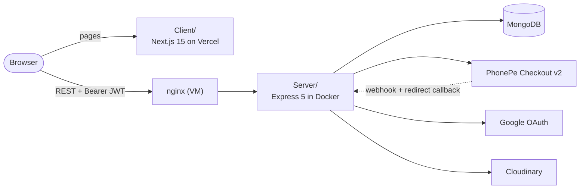
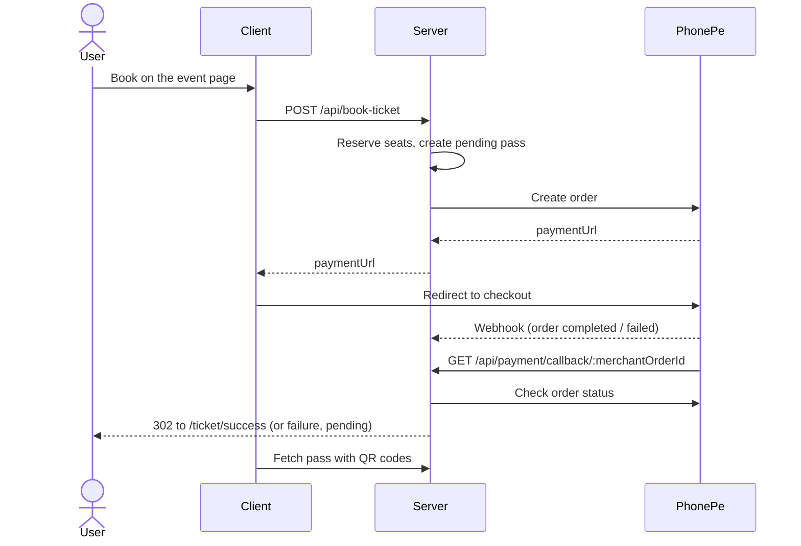
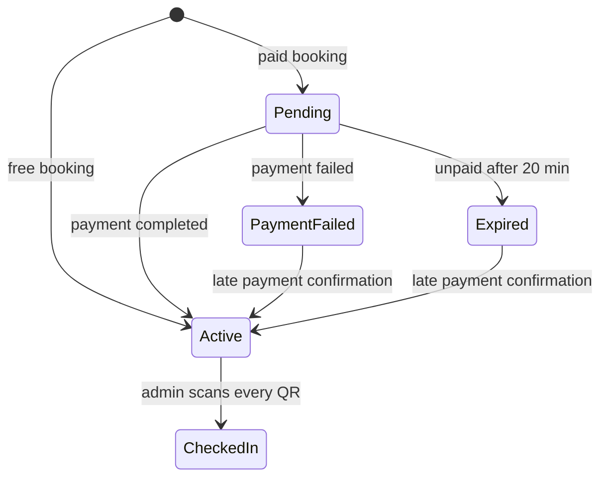

<p align="center">
  
</p>

<h1 align="center">Talkeys</h1>

<p align="center">Event ticketing: browse events, book passes, get a QR ticket, scan it at the door.</p>

<p align="center">
  <a href="LICENSE"></a>
  
  
  
</p>

## About

Talkeys lets people browse events, book free or paid passes, get a QR ticket, and lets organizers scan tickets at the door.

> **Status: being sunset.** The team is shutting Talkeys down. The Client stays on Vercel and the API VM will be removed a few weeks after this cleanup. The repository stays public and open for reading and forking.

## How it works



Booking a paid pass:



Pass lifecycle (details in [docs/ARCHITECTURE.md](docs/ARCHITECTURE.md)):



- `Client/`: Next.js App Router, TypeScript, Tailwind, shadcn/ui. Sign-in with Google.
- `Server/`: Express 5 + Mongoose 9 REST API. Domain code lives in `Server/src/modules/<domain>`.
- Pass, payment, event, auth, team and UI state machines are documented with diagrams in [docs/ARCHITECTURE.md](docs/ARCHITECTURE.md).

The two apps are independent (no workspace). **Bun** installs dependencies and runs scripts; the runtime is **Node 24**. Lockfiles are `bun.lock`.

## Quickstart

Prerequisites: Docker with Compose, or Bun 1.4 + Node 24 and a MongoDB.

### Docker (full local stack: mongo + server + client)

```bash
cp Server/.env.example Server/.env      # fill in the secrets you need
docker compose -f compose.yaml -f compose.local.yaml up --build
```

- Client: <http://localhost:3000>
- API: <http://localhost:4890> (for example `/getEvents`)
- The local file overrides `DB_URL` to the bundled `mongo` container, so the stack never touches a remote database.
- `NEXT_PUBLIC_GOOGLE_CLIENT_ID` is passed to the Client build from your shell environment if set.

Stop and wipe: `docker compose -f compose.yaml -f compose.local.yaml down -v`.

### Without Docker

```bash
cp Server/.env.example Server/.env
cp Client/.env.example Client/.env
# start a MongoDB on localhost:27017, then:
./dev.sh                                 # installs deps and runs Server (:8000) and Client (:3000)
```

Or run each app on its own: `cd Server && bun install && bun run dev`, `cd Client && bun install && bun run dev`.

## Configuration

Copy the `.env.example` files and fill in the values. Never commit real values: `*.env` is git-ignored.

### Server (`Server/.env`)

| Variable | Purpose |
| --- | --- |
| `PORT` | HTTP port (default 8000) |
| `NODE_ENV` | `development` or `production` |
| `DB_URL` | MongoDB connection string |
| `FRONTEND_URL` | Client origin, used for payment redirects; also allowed by CORS |
| `CORS_ORIGINS` | Extra comma-separated origins allowed by CORS (talkeys.xyz and www.talkeys.xyz are always allowed) |
| `BASE_URL` | Public URL of this API, used for payment redirects and upload URLs |
| `SECRET` | JWT signing secret |
| `GOOGLE_CLIENT_ID` | Google OAuth client ID used to verify login tokens |
| `BASIC_PASS_REQUIRED_EVENT_IDS` | Comma-separated event IDs that require a basic pass |
| `CLOUDINARY_CLOUD_NAME`, `CLOUDINARY_API_KEY`, `CLOUDINARY_API_SECRET` | Image uploads |
| `PHONEPE_ENV` | `production` or sandbox |
| `PHONEPE_BASE_URL`, `PHONEPE_AUTH_URL`, `PHONEPE_CHECKOUT_SCRIPT` | Optional PhonePe endpoint overrides |
| `PHONEPE_CLIENT_ID`, `PHONEPE_CLIENT_SECRET`, `PHONEPE_CLIENT_VERSION`, `PHONEPE_CLIENT_SECRET_ENCODING` | PhonePe API credentials |
| `PHONEPE_WEBHOOK_USERNAME`, `PHONEPE_WEBHOOK_PASSWORD` | Webhook basic-auth credentials. The webhook returns 503 while they are unset. |

### Client (`Client/.env`)

| Variable | Purpose |
| --- | --- |
| `BACKEND_URL` | API base URL (inlined at build time) |
| `NEXT_PUBLIC_BASE_URL` | Public URL of the Client |
| `NEXT_PUBLIC_GOOGLE_CLIENT_ID`, `GOOGLE_CLIENT_ID` | Google OAuth client ID |
| `NEXT_PUBLIC_CONVENIENCE_FEE` | Fee added to paid tickets in the UI |
| `NEXT_PUBLIC_EVENT_CREATE_URL` | Event creation endpoint override |

## Scripts

| Where | Command | What |
| --- | --- | --- |
| `Server/` | `bun run dev` / `bun run start` | Run with nodemon / plain Node |
| `Server/` | `bun run test` | Node test runner against an in-memory MongoDB (unit and characterization tests) |
| `Server/` | `bun run migrate:pass-types` | One-off data migration for pass types |
| `Client/` | `bun run dev` / `build` / `start` | Next.js dev server, production build, serve build |
| `Client/` | `bun run lint` / `typecheck` | ESLint, `tsc --noEmit` |
| `Client/` | `bun run analyze` | Build with the bundle analyzer |

## Layout

```
Client/src/app          Next.js routes (thin; import from features/)
Client/src/features     Domain code: auth, events, dashboard, admin, marketing
Client/src/components   Shared UI (shadcn primitives, Navbar, Footer)
Server/src/modules      auth, events, passes (booking, payments, scanning), teams, dashboard, admin
Server/src/shared       Middleware, logger, Cloudinary upload
Server/src/routes       router.js: every route, auth level set by position
Server/test             Unit and characterization tests
docs/ARCHITECTURE.md    State machines, route table, known anomalies
compose.yaml            Production-shaped: API only
compose.local.yaml      Adds mongo and client for local use
.github/workflows       Deploy workflow (SSH to the VM, uses DEPLOY_* secrets)
```

## Deployment

- **Client:** Vercel builds every push to `main` and deploys it to production.
- **Server:** `.github/workflows/docker.yml` SSHes to the VM on every push to `main`, resets the checkout to `origin/main` and runs `docker compose up --build -d server`. It needs the repository secrets `DEPLOY_HOST`, `DEPLOY_USER`, `DEPLOY_PATH`, `DEPLOY_SSH_KEY` and `DEPLOY_KNOWN_HOSTS`.
- A MongoDB change that is not automatic: the `qrStrings.id` index on `passes` is now partial. Existing databases must drop the old one once: `db.passes.dropIndex("qrStrings.id_1")`.

## Contributing

Open an issue or a pull request. Run `bun run test` in `Server/` and `bun run typecheck && bun run lint && bun run build` in `Client/` before pushing. Contributors are listed on the [GitHub contributors page](https://github.com/TalkeysOfficial/talkeys/graphs/contributors). Agents and contributors working in the repo should also read [AGENTS.md](AGENTS.md).

## License

Apache-2.0, see [LICENSE](LICENSE).
