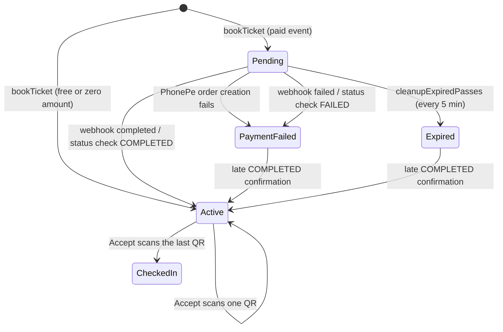
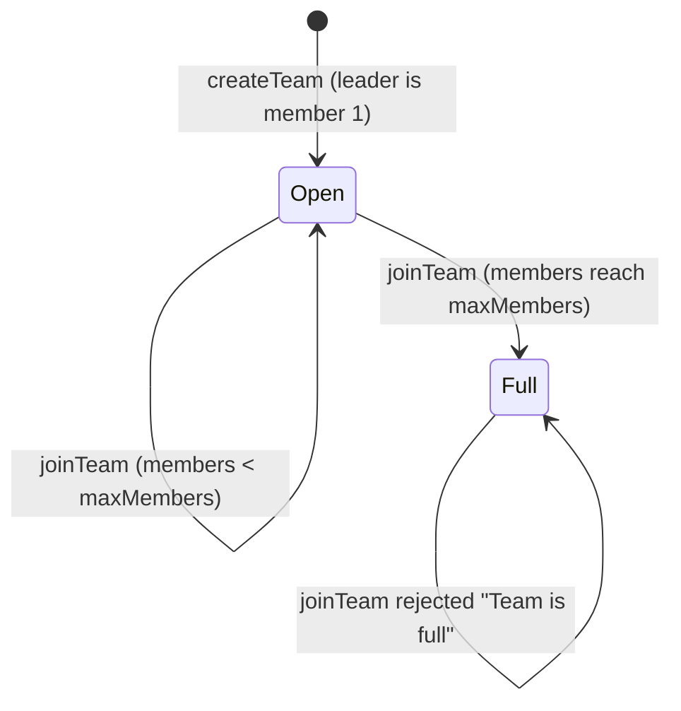

# Talkeys architecture and state machines

This document maps how the system behaves today, including known defects.
It is the reference for the restructure: every transition listed here is
pinned by a characterization test under `Server/test/characterization/`.
Line numbers refer to commit `62e7668` and will drift; symbol names are stable.

## System context

```
Browser ── Client/ (Next.js 15, Vercel) ──HTTP + Bearer JWT──▶ Server/ (Express 5, Docker on VM) ──▶ MongoDB Atlas
                                                                    ├──▶ PhonePe Checkout v2 (orders, status, webhook)
                                                                    ├──▶ Google OAuth (ID token verification at login)
                                                                    └──▶ Cloudinary (event images)
```

- Auth is stateless: `POST /verify` exchanges a Google ID token for a JWT signed with `SECRET`
  (`Server/src/modules/auth/auth.controller.js` `login`). `verifyToken`
  (`Server/src/shared/middleware/oauth.js`) re-reads the user by the token's `email` on every request.
- Server bootstrap: `Server/src/app.js` builds the Express app; `Server/src/server.js` connects Mongo and listens.
  Global middleware order: `express.json` → `urlencoded` → static `/uploads` → morgan (stdout and
  `Server/log/access.log`) → `cookieParser` → `cors()` (any origin) → force JSON content type →
  router → `express-custom-error` handler → 404 JSON.

## Route table

Middleware is positional in `Server/src/routes/router.js`: every route after
`router.use(auth.verifyToken)` needs a JWT, and every route after
`router.use(checkRole(["admin"]))` also needs `role: "admin"`.

| Access | Method and path | Handler |
|---|---|---|
| public | GET `/api/payment/callback/:merchantOrderId` | `Passes.handlePaymentCallback` |
| public | POST `/api/payment/webhook`, POST `/payment/webhook` | `Passes.handlePaymentWebhook` |
| public | GET `/getEvents`, GET `/getEventById/:id` | `Events.getEvents`, `Events.getEventById` |
| public | POST `/verify`, GET `/logout` | `authentication.login`, `authentication.logout` |
| JWT | `/dashboard/profile` (GET, PATCH), GET `/dashboard/events`, GET `/dashboard/activity` | `dashboard.controller` |
| JWT + organizer | `/dashboard/create-event`, `/edit-event/:id`, `/participants/:id`, `/approve-participant/:id`, `/export-participants/:id`, `/event-analytics/:id` | `dashboard.controller` |
| JWT | POST `/register` | `Events.registerForInfluencer` |
| JWT (owner or admin, else 403) | GET `/api/ticket-status/:passId` | `Passes.getTicketStatus` |
| JWT | POST `/createTeam`, POST `/joinTeam` | `Teams.createTeam`, `Teams.joinTeam` |
| JWT | POST `/api/book-ticket`, POST `/bookPass` | `Passes.bookTicket` |
| JWT | GET `/api/passbyuuid/:passUUID`, POST `/getPass` | pass lookups |
| JWT | POST `/likeEvent/:id`, POST `/unlikeEvent/:id`, GET `/getAllLikedEvents` | likes |
| JWT | POST `/reqEvent` | `Events.reqEventt` |
| JWT + admin | GET `/CanScan`, GET `/regisDetails` | scanner capability, registrations |
| JWT + admin | POST `/accept`, POST `/Accept`, POST `/api/getTix` | `Passes.Accept` (check-in scan), `Passes.getPassByQrStringsAndPassUUID` |
| JWT + admin | `/admin/events` (GET, POST), `/admin/events/:eventId` (GET, PUT), `/admin/events/:eventId/stats`, POST `/admin/event-images`, POST `/addEvent`, DELETE `/deleteSpecificEvent/:eventId` | event management |

The dashboard router is mounted before the global `verifyToken`, but applies its own.

Not routed: `cleanupExpiredPasses` (`modules/passes/passes.controller.js`) runs every 5 minutes from `server.js`.
Dead code (contact, registration, websocket, team verification, email service and templates, four unrouted pass handlers, the unused `Registration` model) was removed in Phase 4a; see git history before that commit.

## 1. Pass lifecycle (core)

A `Pass` (`Server/src/modules/passes/passes.model.js`) carries three overlapping status fields that always move together:

| Field | Enum | Default |
|---|---|---|
| `status` | pending, active, payment_failed, expired, revoked | pending |
| `passStatus` | active, inactive, expired, revoked | inactive |
| `paymentStatus` | completed, pending, failed, refunded | pending |

Composite states as written by code (`status / passStatus / paymentStatus`):



| From | To | Trigger | Guard | Side effects | Code |
|---|---|---|---|---|---|
| none | Pending `pending/inactive/pending` | `bookTicket`, paid event and amount > 0 | JWT, event published and registration open, no active or unexpired pending pass for this user and event (409), quantity ≤ 10 per selection, team membership, basic-pass rule, inventory | reserves seats, creates PhonePe order, `expiresAt = now + 20 min` | `booking.service.js` `createBooking` |
| none | Active `active/active/completed` | `bookTicket`, free or amount 0 | JWT, event published and registration open, no active or unexpired pending pass for this user and event (409), quantity ≤ 10 per selection, team membership, basic-pass rule, inventory | reserves seats, `qrStrings` built, `passUUID` set by pre-save | `createBooking` |
| Pending | PaymentFailed `payment_failed/inactive/failed` | PhonePe order creation throws | none | releases seats; HTTP 500 | `createBooking` (PhonePe order catch) |
| Pending, PaymentFailed, Expired | Active `active/active/completed` | webhook `checkout.order.completed`; status check `COMPLETED` (callback, `getTicketStatus`) | pass found by `merchantOrderId`; re-reserves seats if released | `passUUID`, `qrStrings`, `confirmedAt`, `$inc activePasses` on the user (field is not in the User schema, so it is silently dropped) | `processPaymentConfirmation` |
| Active | Active | repeat confirmation | `paymentStatus === completed` | repairs missing UUID or QR, no double count | `processPaymentConfirmation` |
| any non-completed | PaymentFailed | webhook `checkout.order.failed`; status check `FAILED` | `paymentStatus !== completed` | releases seats | `processPaymentFailure` |
| Pending past `expiresAt` | Expired `expired/expired/failed` | `cleanupExpiredPasses` | none | releases seats | `server.js` timer, every 5 min |
| completed payment | `status = active` | organizer `PUT /dashboard/approve-participant/:id` | event `organizerEmail` matches; `paymentStatus === completed`, else 409 | none | `dashboard.controller.js` `approveParticipant` |
| Active | Active / checked in | `POST /accept` with `uuid`, `qrId` | `paymentStatus === completed`; QR exists; not already scanned (409) | `qrStrings[i].qrScanned`, `scannedAt`; `isScanned` and `timeScanned` once all QRs are scanned | `Accept` |

Invariants and defects (fixed items say so; the rest are still open and pinned by tests):

- **Webhook authentication.** Fixed: without `PHONEPE_WEBHOOK_USERNAME` and `PHONEPE_WEBHOOK_PASSWORD` the webhook returns 503; with them it checks `SHA256(username:password)`, a static shared secret.
- **Amount check.** Fixed: a webhook whose top-level `amount` (paise) differs from `pass.amount × 100` is rejected with 400; a payload without an amount is still accepted.
- **Check-in is admin-only.** Fixed: `/accept`, `/Accept` and `/api/getTix` sit after `checkRole(["admin"])`. Still open: scanning re-activates a `revoked` pass whose payment is completed.
- **`approveParticipant` requires payment.** Fixed: it returns 409 unless `paymentStatus === completed`.
- **`approveParticipant` issues a QR without payment.** That pass cannot be scanned, because `Accept` requires `paymentStatus === completed`.
- **Duplicate bookings.** Fixed per user: a second booking for the same event returns 409 while the user holds an active or unexpired pending pass. Still open: another team member can book the same team again.
- **Bookings respect registration state.** Fixed: `bookTicket` rejects events that are not `published` or have `isRegistrationOpen === false`. Dates and `isLive` are still not checked.
- **`getTicketStatus` needs login.** Fixed: only the pass owner or an admin gets the pass (else 403).
- **Several unpaid passes can coexist.** Fixed: the `qrStrings.id` unique index is partial, so empty `qrStrings` no longer collide. Existing databases must drop the old index once (see README, Deployment).
- **Only one unpaid pass can exist at a time.** `qrStrings.id` has a unique index that is not sparse (`passes.model.js`), so every unpaid pass (empty `qrStrings`) indexes as `null` and a second one fails with E11000 (HTTP 500). Applies wherever the index is built.
- **Plain-text and HTML responses are labelled `application/json`.** The global content-type middleware sets it for every non-multipart response, including the payment error redirect page and `/logout`.

## 2. Event inventory

Seats are counted twice: event-level `registrationCount` against `totalSeats`, and per pass type
`passTypes[].bookedQuantity` and `soldQuantity` against `maxAvailable`.

| Step | Effect | Code |
|---|---|---|
| reserve | atomic `$inc registrationCount` only if `registrationCount + n <= totalSeats`, else HTTP 400 "Insufficient tickets available" | `reserveSeats`, `reserveBookingInventory` |
| reserve pass types | per selection, atomic `$inc` on an active pass type with capacity; on failure the event-level reservation is rolled back | `reservePassTypeSelections` |
| release | `$inc registrationCount -ticketCount`, release pass types, `seatsReserved = false` | `releaseReservedSeats`, `releasePassTypeSelections` |

The `Event` pre-validate hook (`modules/events/events.model.js`) synthesises a single "General Pass" from
`ticketPrice` and `totalSeats` when `passTypes` is empty.

## 3. Event visibility and registration

- `status` enum `draft | published | cancelled`, default `published`. No code writes `draft` or `cancelled`.
- `isRegistrationOpen`, `isLive` and `startRegistrationDate` are set by admins and organizers through create and edit.
- `getStatus()` (`modules/events/events.model.js`) derives a display state: not `isRegistrationOpen` → `registration_closed`; before `startRegistrationDate` → `coming_soon`; `isLive` → `live`; else `ended`.
- `getEvents` only lists events with `status` not `draft` and `visibility: "public"`, ignores operator objects in filters, escapes `search` before `$regex`, whitelists `sortBy` and caps `limit` at 100. `getEventById` returns 404 for drafts. The response `status` field is still the derived `getStatus()` value, which overwrites the stored `draft | published | cancelled`.

## 4. Team membership



- `createTeam` (`modules/teams/team.controller.js`) requires an `isTeamEvent` event and a user not already in a team for that event. It retries code generation 5 times.
- `joinTeam` is idempotent for existing members (200). It rejects members of another team for the same event and full teams. The capacity check is read-then-write, not atomic.
- The Client has no team UI or team API call (unused ones were removed in Phase 4a). The Server endpoints stay and are covered by tests.
- Booking a team event requires `teamCode` and membership (`getTeamBooking`). Other members become `friends` on the pass.

## 5. Identity and roles

- `User.role` enum `user | admin | organizer`, default `user` (`users.model.js`). No route changes a role; it is set directly in the database.
- `verifyToken` responses: no token 403, bad token 401, unknown email 404.
- `checkRole` rejects other roles with 403. `canScan` and `admnDetails` re-check `admin` inside the handler. Because `checkRole(["admin"])` guards everything after it, an unknown path returns 403 to non-admins; only admins reach the JSON 404.
- `PATCH /dashboard/profile` only writes `displayName`, `about`, `pronouns` and `avatarUrl`; its response omits `accessToken` and `refreshToken`. `/verify` rejects Google tokens without `email_verified: true`.

## 6. Client payment flow

1. Event page → `POST /api/book-ticket` (or `/bookPass`).
2. Free: the Client shows the pass from the response. Paid: the browser goes to the PhonePe `paymentUrl`.
3. PhonePe → `GET /api/payment/callback/:merchantOrderId`. The Server checks the status with PhonePe, applies the transition, then sends a 302 to `FRONTEND_URL/ticket/{success,failure,pending}`. Errors send `/ticket/error`, a page the Client does not have.
4. `/ticket/success` fetches the pass by `passId` and `uuid`. `/ticket/pending` does not poll.

## Other stored state without transitions

- `reqEvent`: created by `POST /reqEvent`; never approved or read by any route.
- `InfluencerRegistration`: created by `POST /register`.
